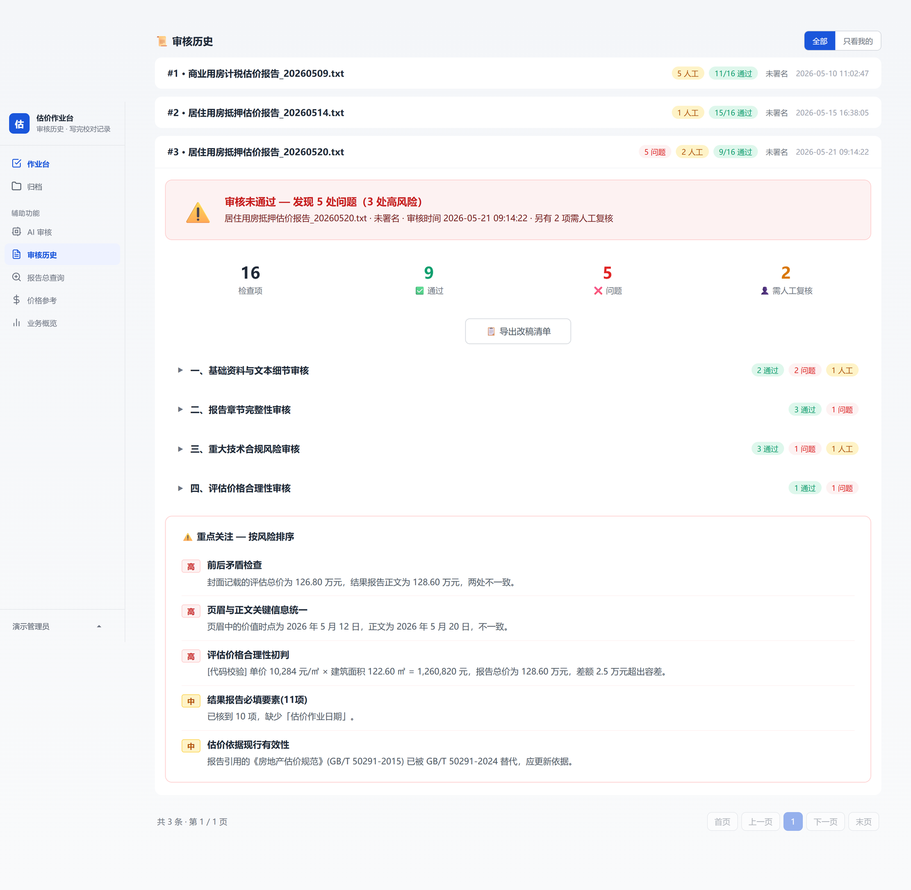
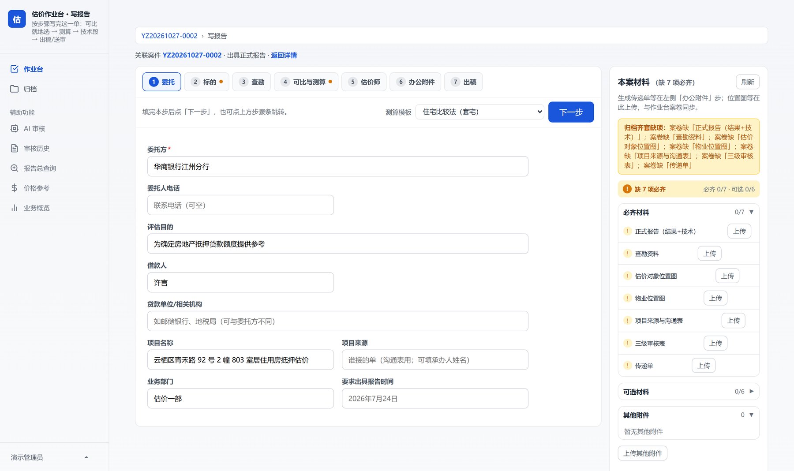
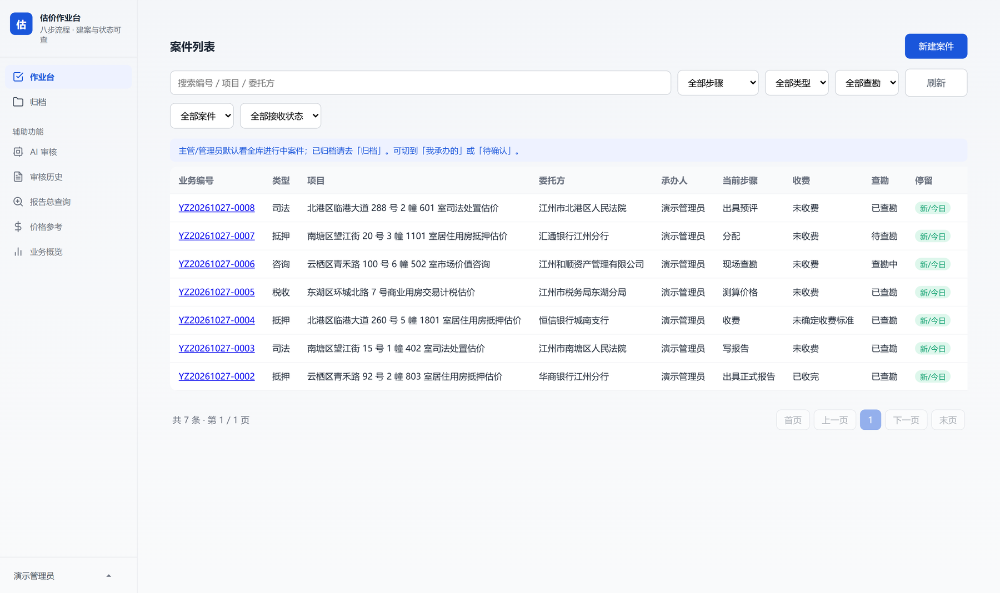
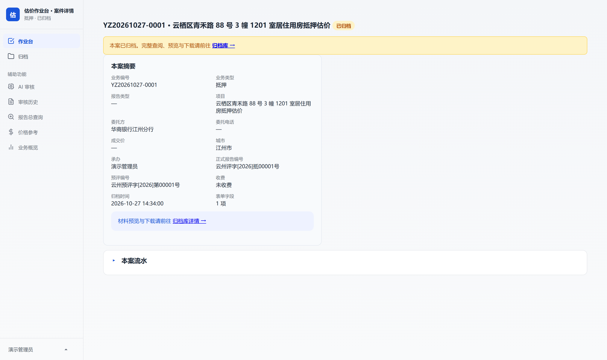
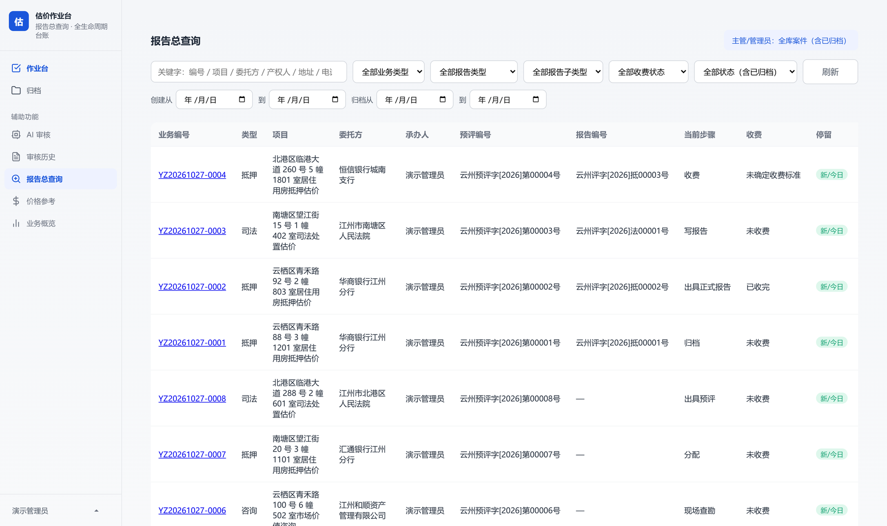
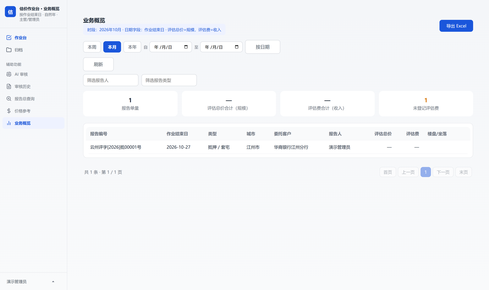
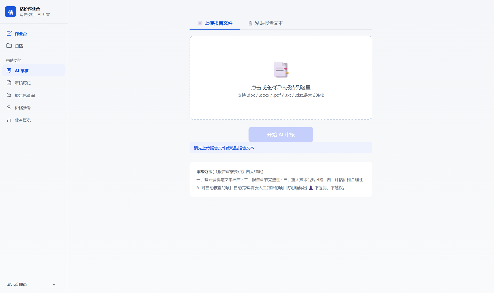

# 估价报告 AI 审核工作台

面向房地产估价机构的本地化审核系统。把「报告出稿前逐页翻一遍」，改成「AI 预审 + 代码复核 + 人工兜底」的三层流程。

> 本仓库为**作品展示**，不含源代码。截图中的项目名、机构、地址、人名、金额均为虚构演示数据。

---

## 要解决的问题

房地产估价报告在出具前要过一整套合规检查：基础资料对不对、章节齐不齐、依据是不是现行有效、价格算不算得平。这件事的现实情况是：

- 一份报告人工通读要 1–2 小时，业务高峰期根本翻不完；
- 判断标准装在资深估价师脑子里，换个新人结论就不一样；
- 最容易出事的不是「看不懂的复杂问题」，而是金额大小写不一致、章节漏一项、引用了已废止的规范这类**机械性疏漏**；
- 报告一旦出具要签字负责，出了错是执业风险。

所以这套系统的定位不是「替代审核人」，而是**把可判定的部分机器先过一遍，把人的注意力留给真正需要判断的地方**。

## 核心设计：三道判定

这是整个系统最关键的部分。单纯把报告丢给大模型问「有没有问题」，得到的是不可交付的结果——模型会漏算术、会自相矛盾、会把模板化表述当成错误。所以判定被拆成三层：

| 层 | 负责什么 | 举例 |
|---|---|---|
| **模型判定** | 需要读懂语义的部分 | 表述是否规范、前后是否矛盾、依据引用是否匹配业务类型 |
| **代码复核** | 必须算准的部分 | 金额大小写换算、单价×面积与总价是否对得上、日期时序、可比实例时效、废止规范名单 |
| **交叉纠偏** | 两层结论冲突时 | 模型说「通过」但算术不平 → 以代码为准推翻；模型报的问题经复核属误报 → 自动撤回 |

关键原则写在产品逻辑里：**两边都拿不准的，标注「需人工复核」，不给假结论。** 审核结论要有人签字，机器只能提供依据，不能替人下判断。

这一层设计带来的直接效果：误报率降下来，人工才愿意用；漏报率降下来，报告才敢发。

## 四个审核维度

审核范围对齐估价行业的报告审核要点，拆成四个维度、十余个检查点：

| 维度 | 关注点 |
|---|---|
| 一、基础资料与文本细节 | 金额大小写、前后矛盾、页眉与正文一致性、文字规范、特殊情形披露 |
| 二、报告章节完整性 | 法定前置章节、结果报告必填要素、技术报告核心模块、附件完整性 |
| 三、重大技术合规风险 | 估价依据现行有效性、价值时点与查勘日期时序、估价目的表述、可比实例合规性 |
| 四、评估价格合理性 | 单价×面积与总价的算术校验、与同类成交数据的量级比对 |

未通过时按**风险等级排序**给出重点项，可直接导出改稿清单。每条结论都能追到原文位置。

## 从审核工具长成一套作业台

单点工具没人愿意天天开两个系统。所以审核能力被嵌进完整的业务流程里：

| 模块 | 能力 |
|---|---|
| 写报告 | 七步向导（委托 → 标的 → 查勘 → 测算 → 估价师 → 办公附件 → 出稿），自动测算、可比实例参考、技术段辅助生成、Word 出稿 |
| 案件流转 | 九步状态机（登记 → 分配 → 查勘 → 测算 → 预评 → 收费 → 写报告 → 正式报告 → 归档），预评阶段可分叉为「只出预评」或「转正式报告」 |
| 案卷管理 | 按报告类型校验材料齐套性，缺哪项直接列出来 |
| 报告总查询 | 全生命周期检索，已归档案件一并覆盖 |
| 业务统计 | 报告量、评估规模、评估费收入，可导出 Excel |
| 权限与审计 | 三级角色（估价师 / 主管 / 管理员），登录失败锁定，关键操作留痕 |
| 反馈闭环 | 审核结论可标「误报」，同类误报累计到阈值后生成规则修正建议，由管理员批准生效 |

## 几个设计取舍

**为什么是本地部署，不是 SaaS。**
报告里是当事人产权信息、银行委托信息、未公开的评估结论。这类数据不适合走公网，也不适合放在第三方服务器上。所以整套系统设计成单机部署，模型接口可切换到符合要求的内网或私有化端点。

**为什么 AI 之外还要写一层代码校验。**
实际跑下来，模型有两类稳定缺陷：一是「结论说没问题、状态却填失败」的自相矛盾；二是金额、算术这类它算不准但看起来很像对的内容。这两类恰好是审核里最不能错的。所以凡是有确定答案的判定，都不交给模型。

**为什么不追求全自动。**
估价报告是要签字的执业文件。系统能给出的最好结果是「按证据列出问题清单 + 明确标出哪些必须人看」，而不是「判定这份报告合格」。产品里所有涉及判断的地方都保留人工出口，这是刻意设计，不是能力不足。

## 技术构成

| 层面 | 选型 |
|---|---|
| 服务端 | Python + Flask，单进程本地服务 |
| 数据 | SQLite，业务库 / 账号库 / 语料索引 / 价格库分离 |
| 前端 | 原生 JavaScript，无构建链 |
| 文档解析 | Word / PDF / Excel 正文与表格提取 |
| OCR | 本地识别权证与扫描件 |
| 检索 | SQLite 全文索引，语料留在本地 |
| 模型 | OpenAI 兼容接口，厂商可切换 |

选型原则是**降低部署门槛**：目标机器不需要装环境、不需要联网装依赖、不需要运维。整个系统打成便携包，解压双击就能用。

## 工程化程度

- 便携运行时，目标机免装 Python 环境
- 一键打包三种模式：纯代码包 / 服务器部署包 / 含语料库的即用包
- 注册为 Windows 服务，开机自启
- 定时备份 + 恢复脚本
- 数据库迁移、账号初始化、密码重置均有独立脚本
- 自研代码约 7 万行（含前端）

## 说明

- 本仓库仅用于作品展示，**不提供源代码、不提供可运行版本**。
- 所有截图来自演示环境，数据为虚构。
- 如需了解具体实现思路，可当面演示与讲解。

© 保留所有权利。未经许可不得复制、部署或用于商业用途。
